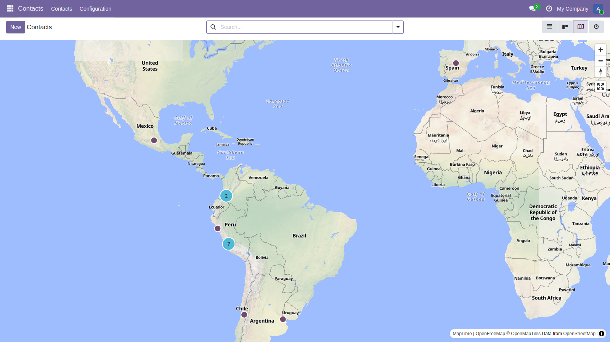
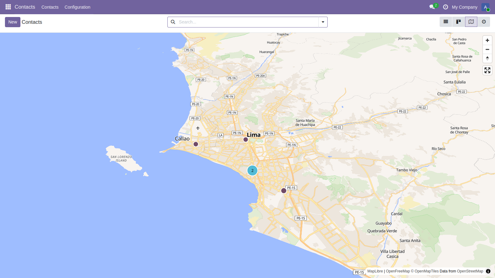
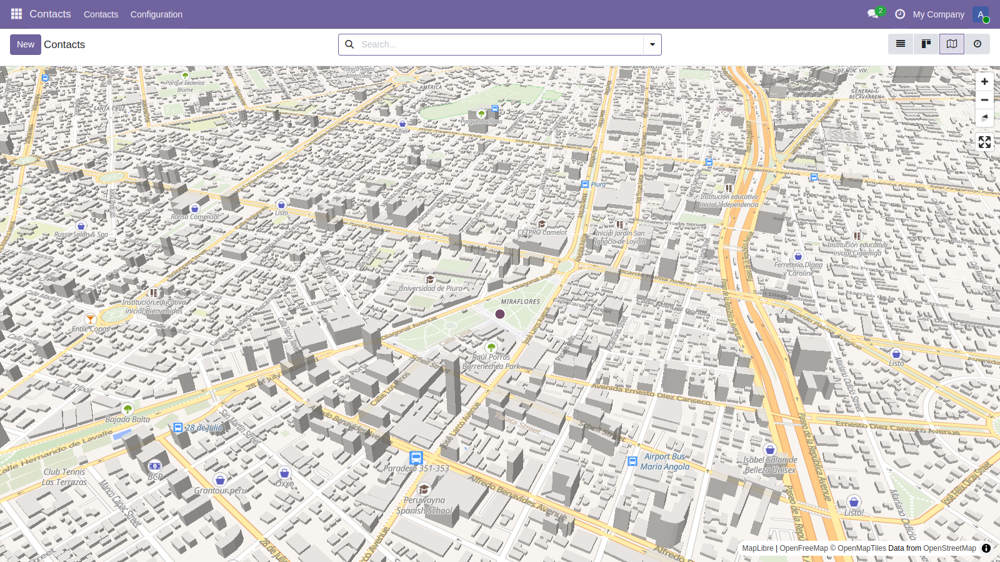
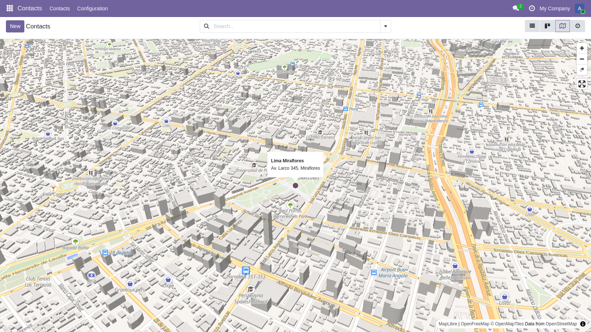

# odoo-maplibre

Odoo 19.0 modules that bring **MapLibre GL JS** (WebGL, vector tiles) to the web client.
Maintained by API SERVICE S.A.C.

| Module | Description |
|---|---|
| `web_maplibre_lib` | Bundles MapLibre GL JS 5.9.0 + PMTiles protocol, and the style configuration. |
| `web_view_maplibre_map_partner` | MapLibre map view in Contacts. |
| `web_view_maplibre_map` | New `maplibre_map` view: GeoJSON clustering, popups, search/filter integration. |

## Screenshots

Contacts on the map, fitted to the markers, with clusters:



Zoom on a city:



Tilted map with 3D buildings when the view is close enough:



A click on a marker shows a popup that opens the record:



## Usage

```xml
<record id="view_partner_maplibre" model="ir.ui.view">
    <field name="model">res.partner</field>
    <field name="arch" type="xml">
        <maplibre_map
            field_latitude="partner_latitude"
            field_longitude="partner_longitude"
            field_title="name"
            field_address="contact_address"
        >
            <field name="partner_latitude"/>
            <field name="partner_longitude"/>
            <field name="name"/>
            <field name="contact_address"/>
        </maplibre_map>
    </field>
</record>
```

Then add `maplibre_map` to the `view_mode` of the action. Optional attributes:
`default_zoom` (7), `max_zoom` (19), `pitch` (45, map tilt in degrees), `limit` (5000 records).

## Map sources

Configured with system parameters (see `web_maplibre_lib`):

| Source | Cost | Key |
|---|---|---|
| OpenFreeMap (default) | Free | No |
| Self-hosted Protomaps / PMTiles (`pmtiles://` in your style.json) | Free | No |
| MapTiler, Stadia, custom `style.json` | Free tier / paid | Optional |

MapLibre GL requires WebGL. Without it the view shows a message; use the Leaflet view instead.

## Status

- Python tests (15) and Hoot tests (5) pass on Odoo 19.0.
- The map renders in Odoo 19 (manually verified). Without records with coordinates it shows the whole world; otherwise it fits the records.
- Roadmap: marker images, record list panel, style switcher, routing (OSRM/Valhalla), polygon layers, Odoo 20.0 port.

## Upstream proposal

These modules are proposed for inclusion in OCA/geospatial: [OCA/geospatial#494](https://github.com/OCA/geospatial/issues/494).

## Credits

The module icons are the official MapLibre app icon (© MapLibre contributors).

## License

AGPL-3.0. Bundled libraries: MapLibre GL JS (BSD-3-Clause), PMTiles (BSD-3-Clause).
