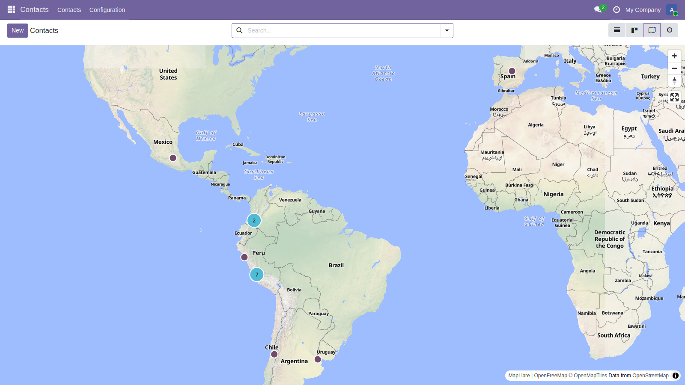
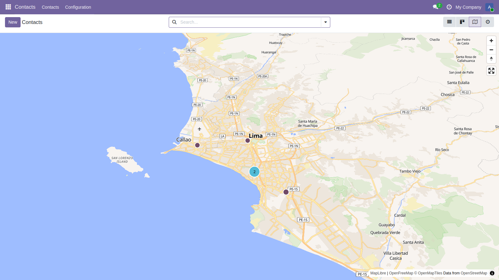
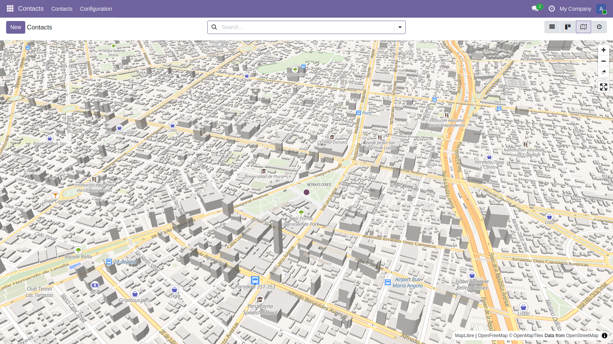
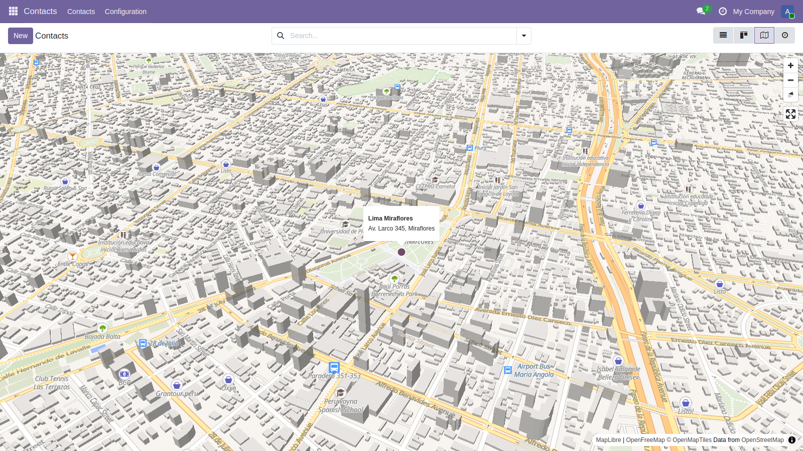

.. image:: https://odoo-community.org/readme-banner-image
   :target: https://odoo-community.org/get-involved?utm_source=readme
   :alt: Odoo Community Association

==============================
MapLibre Map View for Partners
==============================

.. 
   !!!!!!!!!!!!!!!!!!!!!!!!!!!!!!!!!!!!!!!!!!!!!!!!!!!!
   !! This file is generated by oca-gen-addon-readme !!
   !! changes will be overwritten.                   !!
   !!!!!!!!!!!!!!!!!!!!!!!!!!!!!!!!!!!!!!!!!!!!!!!!!!!!
   !! source digest: sha256:81593a62442d302fffc349e9e0c06412a189cdaaf7edb268a6a04e35812f51a6
   !!!!!!!!!!!!!!!!!!!!!!!!!!!!!!!!!!!!!!!!!!!!!!!!!!!!

.. |badge1| image:: https://img.shields.io/badge/maturity-Beta-yellow.png
    :target: https://odoo-community.org/page/development-status
    :alt: Beta
.. |badge2| image:: https://img.shields.io/badge/license-AGPL--3-blue.png
    :target: http://www.gnu.org/licenses/agpl-3.0-standalone.html
    :alt: License: AGPL-3
.. |badge3| image:: https://img.shields.io/badge/github-apiservicesac%2Fodoo--maplibre-lightgray.png?logo=github
    :target: https://github.com/apiservicesac/odoo-maplibre/tree/19.0/web_view_maplibre_map_partner
    :alt: apiservicesac/odoo-maplibre

|badge1| |badge2| |badge3|

This module adds a MapLibre map view (vector tiles) to the Contacts app.
The partners that have a latitude and a longitude (see
``base_geolocalize``) are displayed on the map.

**Table of contents**

.. contents::
   :local:

Configuration
=============

Partners are placed on the map with their latitude and longitude. They
can be computed from the address with the geolocation feature of the
partner form (see ``base_geolocalize``).

Usage
=====

- Go to *Contacts*, a new map icon is available in the view switcher.
- All the partners that have coordinates are displayed. The map is
  fitted to them, and close markers are grouped in clusters.

|Contacts on the map|

- Click on a cluster to zoom into it, or zoom with the mouse wheel.

|Zoom on Lima|

- The map is tilted by default. When the view is close enough, the
  buildings are displayed in 3D.

|3D buildings|

- Click on a marker to display the name and the address of the partner.
  Click on the popup to open the partner form.

|Popup of a partner|

- When no displayed partner has coordinates, the whole world is
  displayed.

Bug Tracker
===========

Bugs are tracked on `GitHub Issues <https://github.com/apiservicesac/odoo-maplibre/issues>`_.
In case of trouble, please check there if your issue has already been reported.
If you spotted it first, help us to smash it by providing a detailed and welcomed
`feedback <https://github.com/apiservicesac/odoo-maplibre/issues/new?body=module:%20web_view_maplibre_map_partner%0Aversion:%2019.0%0A%0A**Steps%20to%20reproduce**%0A-%20...%0A%0A**Current%20behavior**%0A%0A**Expected%20behavior**>`_.

Do not contact contributors directly about support or help with technical issues.

Credits
=======

Authors
-------

* API SERVICE S.A.C.
* Josue Salazar

Contributors
------------

- API SERVICE S.A.C. (https://www.apiservicesac.com)
- Josue Salazar (josuesp1620@gmail.com)

Maintainers
-----------

This module is part of the `apiservicesac/odoo-maplibre <https://github.com/apiservicesac/odoo-maplibre/tree/19.0/web_view_maplibre_map_partner>`_ project on GitHub.

You are welcome to contribute.
