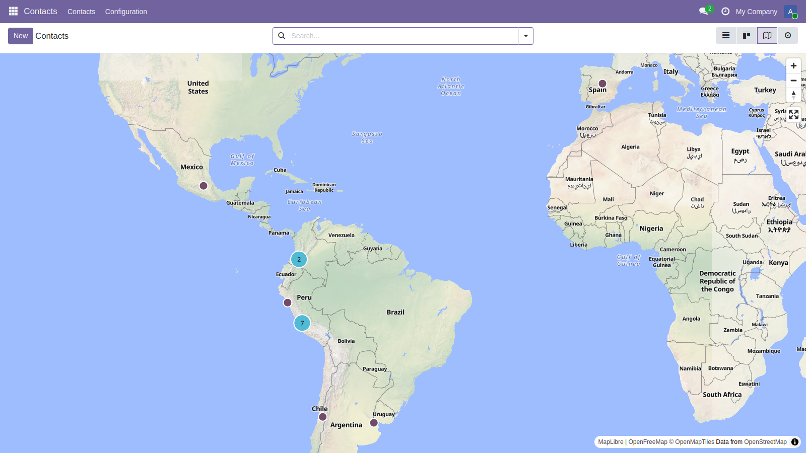
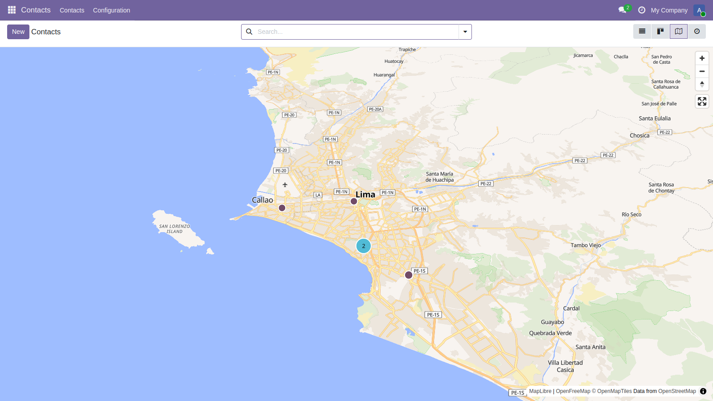
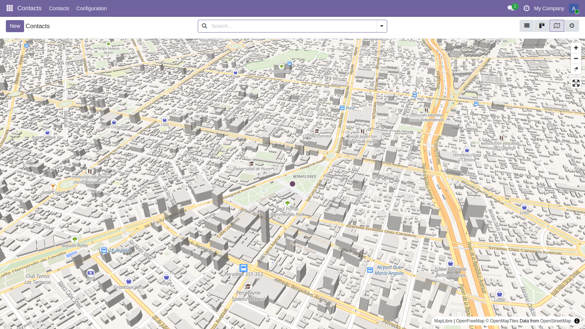
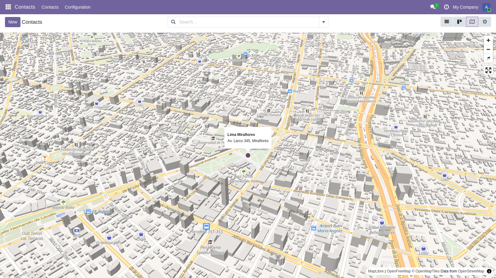

- Go to *Contacts*, a new map icon is available in the view switcher.
- All the partners that have coordinates are displayed. The map is fitted to
  them, and close markers are grouped in clusters.

- Click on a cluster to zoom into it, or zoom with the mouse wheel.

- The map is tilted by default. When the view is close enough, the buildings
  are displayed in 3D.

- Click on a marker to display the name and the address of the partner. Click
  on the popup to open the partner form.

- When no displayed partner has coordinates, the whole world is displayed.
